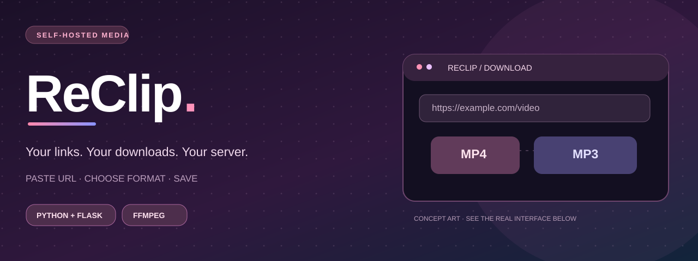

<div align="center">



# ReClip

**Save video or audio from a link, on your own server.**

A lightweight, self-hosted web interface powered by `yt-dlp` and FFmpeg.


[](LICENSE)

[**See the demo**](assets/preview.mp4) · [Features](#features) · [Quick start](#quick-start) · [Self-host](#deployment) · [Usage](#usage)

</div>

---

Paste a supported media URL, inspect the available formats, and choose **MP4 video** or **MP3 audio**. ReClip combines a small Flask backend with a framework-free frontend; the download runs on **your server**, not in a third-party conversion website.

| 🎬 Video & audio | 🖥️ Your infrastructure | ⚡ Lightweight UI |
| :--- | :--- | :--- |
| Choose MP4, MP3 and supported quality options. | Docker or a local Python environment, with downloaded files under your control. | No frontend framework, build step or external account required by ReClip. |


**[▶ Watch ReClip in action](assets/preview.mp4)** — demonstration video from this repository.


*Actual project screenshot. The header banner is conceptual artwork.*

## Features

- Download videos from 1000+ supported sites (via [yt-dlp](https://github.com/yt-dlp/yt-dlp))
- MP4 video or MP3 audio extraction
- Quality/resolution picker
- Bulk downloads — paste multiple URLs at once
- Automatic URL deduplication
- Clean, responsive UI — no frameworks, no build step
- Single Python file backend (~150 lines)

## Quick Start

```bash
brew install yt-dlp ffmpeg    # or apt install ffmpeg && pip install yt-dlp
git clone https://github.com/neosoda/reclip.git
cd reclip
./reclip.sh
```

Open **http://localhost:8899**.

## Deployment

### Coolify / Docker Compose

This project is optimized for [Coolify](https://coolify.io/). You can deploy it using the provided `docker-compose.yml`:

1. Create a new "Docker Compose" resource in Coolify.
2. Paste the contents of `docker-compose.yml` or point to this repository.
3. Coolify can handle the build, persistent volume for downloads, and health checks.

Or manually with Docker:

```bash
docker build -t reclip .
docker run -p 8899:8899 -v reclip_data:/app/downloads reclip
```

## Usage

1. Paste one or more video URLs into the input box
2. Choose **MP4** (video) or **MP3** (audio)
3. Click **Fetch** to load video info and thumbnails
4. Select quality/resolution if available
5. Click **Download** on individual videos, or **Download All**

## Supported Sites

Anything [yt-dlp supports](https://github.com/yt-dlp/yt-dlp/blob/master/supportedsites.md), including:

YouTube, TikTok, Instagram, Twitter/X, Reddit, Facebook, Vimeo, Twitch, Dailymotion, SoundCloud, Loom, Streamable, Pinterest, Tumblr, Threads, LinkedIn, and many more.

## Stack

- **Backend:** Python + Flask (~150 lines)
- **Frontend:** Vanilla HTML/CSS/JS (single file, no build step)
- **Download engine:** [yt-dlp](https://github.com/yt-dlp/yt-dlp) + [ffmpeg](https://ffmpeg.org/)
- **Dependencies:** 2 (Flask, yt-dlp)

## Responsible use

This tool is intended for personal use only. Please respect copyright laws and the terms of service of the platforms you download from. The developers are not responsible for any misuse of this tool.

## Frequently asked questions

**Does ReClip bypass DRM or paywalls?** No. ReClip uses yt-dlp and FFmpeg for media it can legitimately access; it does not remove DRM or grant access to protected services.

**Where are downloads stored?** In the app's downloads directory; the Docker command above persists that directory in the `reclip_data` volume.

**Does it require an online conversion service?** No external conversion SaaS is required. The server must still be able to reach the original media source.

## License

[MIT](LICENSE)
